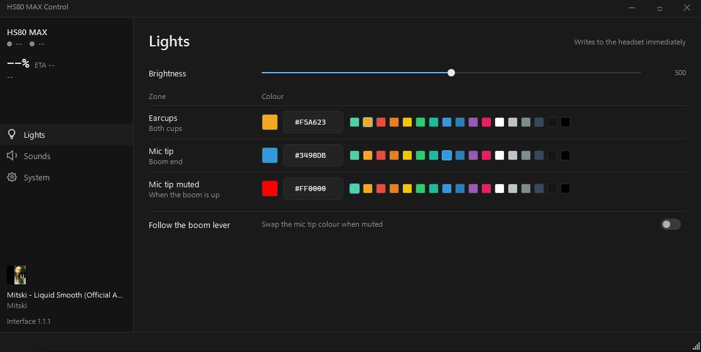

  

  <b>HS80 MAX Control</b> 
  Your headset, without iCUE. 
  <i>LED control · battery and ETA · firmware sound warnings · tray</i>

  

# HS80 MAX Control

A lightweight Windows app for the Corsair HS80 MAX wireless headset. No iCUE, no bloat, no cloud, no telemetry. It talks to the headset directly over its USB dongle.

## What it does

- **Lights** - one row per LED zone: earcups, mic tip, and the mic tip colour used while muted. Pick from the swatch strip or type a hex value. Writes go to the headset as you change things, coalesced at 150 ms so dragging a slider does not flood the dongle.
- **Sounds** - bind any of the headset's 46 firmware prompts to an event: battery low and critical, charging started and complete, headset connected and disconnected, mic mute and unmute. Per-event volume, custom WAV or MP3, tray toast, and LED colour reactions. The last applied colour is restored when the headset reconnects.
- **Battery** - live percentage from the headset meter, charge state, and ETA until empty or full, from a rolling 30 minute fit over measured history.
- **Now playing** - title and artist from the Windows media session, read-only.
- **System** - start with Windows, loopback HTTP server for scripting, and the interface version stamped from the release the build came from.
- **Tray** - minimize or close to the tray so warnings keep working. The tray icon reflects charge level, and the menu toggles the LEDs.

## Roadmap

- [x] Design Overhaul - implemented in 1.1.1
- [ ] Auto-updater
- [ ] Plugins - load small extensions without rebuilding the app
- [ ] Custom themes
- [ ] Equalizer

Feature requests are wanted. Open an issue with the behaviour you want and why.

## Why not iCUE

iCUE is heavy. This app is one process with no child processes, no background service, and no runtime install. It polls the battery every 2 seconds and the mic every 150 ms; nothing else runs when idle. The published exe is a single self-contained file.

## How it talks to the headset

The app speaks the dongle's HID control protocol directly (iface 4, usage page 0xFF42). The battery meter is read from the headset child property 0x0F (raw LE16 / 10), which is the live value. LED writes use the verified open-write-close handle sequence on resource 0x22, with the render mode held in software so colours persist.

## Credits

- **ToastKiste21** - original reverse engineering of the HS80 MAX protocol and firmware ([corsair-hs80-max-re](https://github.com/ToastKiste21/corsair-hs80-max-re), MIT). His work documented the RACE channel and the voice-prompt partition.
- This project independently re-verified the protocol against the current firmware after noticing his build was older than my own unit in use. All 46 voice prompt files shipped in this app were dumped live from the headset over the RACE channel (RFCOMM 21) and extracted from the ROFS partition, not copied from his release.

## Building

Requires .NET 10 SDK on Windows:

    git clone https://github.com/BrokeSkill/hs80-max-control

    cd hs80-max-control

    dotnet publish Hs80.App/Hs80.App.csproj -c Release -r win-x64 --self-contained true -p:PublishSingleFile=true -o out

The exe lands in `out/Hs80.App.exe`. No runtime install needed.

## Layout

- `Hs80.Core` - protocol layer, LED controller, battery reader, event poller, ETA, config
- `Hs80.Audio` - NAudio playback, preset catalog
- `Hs80.Http` - loopback LED/battery HTTP server
- `Hs80.App` - WPF shell: rail with three panes, one shared colour control
- `Hs80.App/Assets` - the 46 firmware voice prompts, icons, screenshots

## License

MIT. The firmware audio files are Corsair's; they are shipped for interoperability with a device you own.
